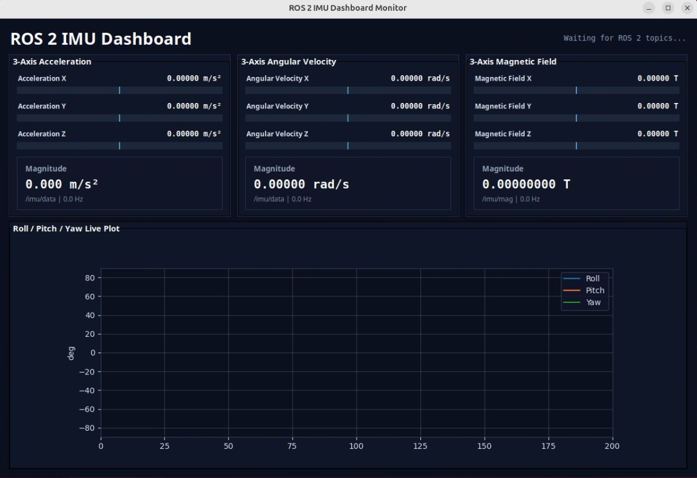

# ROS 2 IMU Dashboard Monitor

A simple ROS 2 dashboard sample for monitoring IMU-related topics in real time.

This sample subscribes to acceleration, angular velocity, magnetic field, and Euler angle topics, then displays the data in a desktop UI with live value bars and a Roll / Pitch / Yaw plot.

It is intended for demos, sensor bring-up, and visual monitoring of sampled ROS 2 data. This build separates received message rate from processed data rate and applies a fixed processing limit to each input subscription.

<p align="center">
  
</p>

---

## Features

- Subscribe to ROS 2 IMU-related topics
- Display 3-axis acceleration
- Display 3-axis angular velocity
- Display 3-axis magnetic field
- Display Roll / Pitch / Yaw as a live plot
- Show received message rate (RX) and processed data rate (Processed) separately
- Apply a fixed 100 Hz processing limit per input subscription, using a minimum 10 ms interval between accepted samples
- Show waiting, measuring, and idle states for message-rate statistics
- Reject non-finite Euler samples and avoid unbounded angle-normalization loops
- Support ROS 2 parameters through `--ros-args`
- Support demo-friendly Euler angle handling:
  - initial zero reference
  - optional periodic auto-zero
  - angle unwrap
  - light smoothing
  - display clipping

---

## Demo Scope

This sample is only a monitor dashboard.

It does **not**:

- publish motor commands
- control hardware
- send MAVLink / PX4 commands
- use a camera
- run an AI model
- modify or republish the source IMU messages

The program subscribes to ROS 2 topics and visualizes selected samples. Some received samples are intentionally skipped before updating sensor values or plot history. It does not preserve every incoming sample and is not a full-rate data recorder.

---

## System Architecture

The data path has four stages:

1. The ROS 2 subscriptions receive messages from `/imu/data`, `/imu/mag`, and `/filter/euler`. Each callback records an RX event.
2. Each subscription checks its own processing deadline. A sample is skipped if less than 10 ms has elapsed since the previous accepted sample.
3. Accepted samples update the shared state. Euler samples are checked for non-finite values and subtraction overflow before changing that state. A Processed event is recorded only after a data update.
4. The Tkinter UI reads a snapshot at its configured update interval. Matplotlib redraws the Euler plot when its separate plot-update check is due.

The IMU subscription supplies both acceleration and angular velocity, so those two panels share the same RX and Processed rates. Magnetic-field and Euler subscriptions have independent limits and statistics.

---

## Rate Display and Processing Limit

| UI field | Meaning |
|---|---|
| `RX` | Rate of subscription callbacks observed by this application, including samples skipped later. It is not a measurement taken inside the publisher. |
| `Processed` | Rate of samples that actually update the dashboard state after the processing gate and applicable Euler validation. It is not GUI FPS. |
| `Processing limit: 100 Hz / topic` | Fixed processing gate: at least 10 ms between accepted samples for each input subscription. It is an upper-limit policy, not a guaranteed 100 Hz sampling timer. |
| `Last RX` | Time since the most recent callback on any of the three subscriptions. A recent value does not mean that all three topics are active. |

The processing limit does not change the publisher's rate or throttle DDS traffic, message deserialization, or callback dispatch. Callbacks still record RX statistics before the processing gate. The three subscriptions do not share a single 100 Hz quota.

Samples are selected only when callbacks run. Samples arriving before the next processing deadline are skipped rather than retained for later dashboard processing. There is no periodic 100 Hz sampling worker or catch-up processing burst.

Actual Processed rates can be below 100 Hz because of input timing, scheduling, and invalid Euler samples. For example, approximately 200 Hz RX with approximately 77 Hz Processed can be consistent with this gate. Even an input configured for 100 Hz can have samples skipped if actual callback intervals are shorter than 10 ms. These figures are examples, not guaranteed conversion ratios.

RX and Processed are measured rates, not promises about delivery. Their difference is not a network-packet-loss measurement.

### Waiting, measuring, and idle

| Display | Meaning |
|---|---|
| `waiting` | No event has been recorded for that statistic yet. For Processed, this means no sample has updated the corresponding data. |
| `measuring...` | Events have started or resumed, but a new frequency estimate is not available yet. |
| `idle ...s` | No event has been recorded recently enough to keep showing the previous estimate. This alone does not prove the publisher has disconnected. |

Frequency estimates are updated on events after a measurement interval of at least one second. Once a rate is known, the idle threshold is the longer of two seconds or three measured message periods. Before a rate is known, the threshold is two seconds, so a very slow topic can temporarily show idle while its rate is still being established.

When data becomes idle, the rate label changes, but sensor values and plot history retain the last processed data until new samples arrive.

### Known measurement limitation in this build

The 10 ms gate uses sample-acceptance timestamps, while Processed statistics use timestamps recorded when shared-state updates complete. A scheduling delay between those points can make a frequency estimate briefly exceed 100 Hz, even when accepted samples are at least 10 ms apart. A simulated timing case produced approximately 100.9 Hz. Therefore, this build does not guarantee that the displayed Processed estimate is always numerically at or below 100 Hz.

---

## Input Topics

| Topic | Message Type | Used Data |
|---|---|---|
| `/imu/data` | `sensor_msgs/msg/Imu` | linear acceleration, angular velocity |
| `/imu/mag` | `sensor_msgs/msg/MagneticField` | magnetic field |
| `/filter/euler` | `geometry_msgs/msg/Vector3Stamped` | roll, pitch, yaw |

Default topic names can be changed with ROS 2 parameters.

For the Euler topic, this sample assumes:

- `vector.x`: roll
- `vector.y`: pitch
- `vector.z`: yaw

By default, the values are assumed to be in degrees. If the topic publishes
radians, set `euler_rad_to_deg:=true`.

---

## Requirements

Target environment:

- Ubuntu 24.04
- ROS 2 Jazzy
- Python 3

Python / ROS 2 dependencies:

- `rclpy`
- `sensor_msgs`
- `geometry_msgs`
- `tkinter`
- `matplotlib`

Install common dependencies:

```bash
sudo apt update
sudo apt install -y \
  python3-tk \
  python3-matplotlib \
  ros-jazzy-rclpy \
  ros-jazzy-sensor-msgs \
  ros-jazzy-geometry-msgs
```

If you are using a different ROS 2 distribution, replace `jazzy` with your ROS 2 distro name.

---

## Run the Sample

Source your ROS 2 environment first:

```bash
source /opt/ros/jazzy/setup.bash
```
Run with default topics:

```bash
python3 ros2_imu_dashboard_monitor.py
```

Run with custom topics:

```bash
python3 ros2_imu_dashboard_monitor.py --ros-args \
  -p imu_topic:=/imu/data \
  -p mag_topic:=/imu/mag \
  -p euler_topic:=/filter/euler
```

Periodic Euler auto-zero is enabled by default with a 10-second interval:

```bash
python3 ros2_imu_dashboard_monitor.py --ros-args \
  -p euler_auto_zero_sec:=10.0
```

Periodic auto-zero uses the next valid Euler sample accepted for processing after the configured interval has elapsed. That sample becomes the new zero reference; this is not an independent timer that resets the data at an exact instant. This is intended only for demonstration and does not compensate for or correct IMU drift.

Disable periodic Euler auto-zero:

```bash
python3 ros2_imu_dashboard_monitor.py --ros-args \
  -p euler_auto_zero_sec:=0.0
```

When `euler_auto_zero_sec` is set to `0.0`, the dashboard still uses the first valid Euler sample accepted for processing as the zero reference, but it will not re-zero periodically.

---

## ROS 2 Parameters

| Parameter | Default | Description |
|---|---:|---|
| `imu_topic` | `/imu/data` | IMU topic for acceleration and angular velocity |
| `mag_topic` | `/imu/mag` | Magnetic field topic |
| `euler_topic` | `/filter/euler` | Euler angle topic |
| `ui_update_ms` | `100` | Requested UI callback interval in milliseconds. Actual refresh timing also includes processing/rendering time; this is independent of the 100 Hz processing limit |
| `plot_update_ms` | `150` | Minimum elapsed time checked before requesting a plot redraw. This check runs inside the UI update loop; it does not provide an independent redraw timer |
| `plot_buffer_len` | `200` | Maximum number of processed Euler samples retained per curve. This is a sample count, not a fixed time window |
| `euler_rad_to_deg` | `false` | Convert Euler input from radians to degrees |
| `euler_auto_zero_sec` | `10.0` | Re-zero on the next valid processed Euler sample after this interval. Set to `0.0` to disable periodic re-zero; initial zeroing remains enabled |
| `euler_enable_unwrap` | `true` | Unwrap angle changes between processed samples across the +180 / -180 degree boundary |
| `euler_enable_smoothing` | `true` | Apply light smoothing to Roll / Pitch / Yaw plot |
| `euler_smooth_alpha` | `0.25` | Per-processed-sample smoothing factor from `0.0` to `1.0`. Smaller values respond more slowly; response time also depends on the Processed rate |
| `rpy_plot_y_limit_deg` | `90.0` | Set the plot Y-axis limits to `-90°` and `+90°` |
| `rpy_display_clip_deg` | `90.0` | Clip displayed Euler values to the range `[-90°, +90°]` |
| `window_title` | `ROS 2 IMU Dashboard Monitor` | Desktop window title |
| `header_title` | `ROS 2 IMU Dashboard` | Main dashboard title |

The processing limit is fixed at 100 Hz per subscription in this build. It is not an additional ROS 2 parameter. Changing `ui_update_ms` or `plot_update_ms` does not change that limit. For example, `ui_update_ms=100` means a requested UI callback interval of 100 milliseconds, not 100 Hz.

---

## Example: Euler Topic in Radians

If your `/filter/euler` topic publishes Roll / Pitch / Yaw in radians, enable conversion:

```bash
python3 ros2_imu_dashboard_monitor.py --ros-args \
  -p euler_rad_to_deg:=true
```

If your topic already publishes degrees, keep the default value:

```bash
python3 ros2_imu_dashboard_monitor.py --ros-args \
  -p euler_rad_to_deg:=false
```

---

## Example: More Stable Demo Display

For a live demo, you may want a smoother and more stable plot:

```bash
python3 ros2_imu_dashboard_monitor.py --ros-args \
  -p euler_enable_smoothing:=true \
  -p euler_smooth_alpha:=0.2 \
  -p euler_auto_zero_sec:=10.0
```

Smaller `euler_smooth_alpha` values make the curve smoother, but also slower to respond. Smoothing is applied once per processed Euler sample, so a lower Processed rate can produce a slower response in seconds even when the alpha value is unchanged.

---

## Example: Faster Plot Response

For debugging, you may want a faster response and less smoothing:

```bash
python3 ros2_imu_dashboard_monitor.py --ros-args \
  -p euler_enable_smoothing:=true \
  -p euler_smooth_alpha:=0.6 \
  -p plot_update_ms:=80
```

The default `ui_update_ms` is still 100 ms in this example. Because plot timing is checked inside the UI update loop, `plot_update_ms:=80` cannot produce independent redraws every 80 ms while that UI setting remains in effect. The plot can be requested on each UI update, with actual timing affected by rendering and scheduling.

---

## Check ROS 2 Topics

Before running the dashboard, check which input topics are available:

```bash
ros2 topic list
```

Check IMU topic data:

```bash
ros2 topic echo /imu/data
```

Check magnetic field topic data:

```bash
ros2 topic echo /imu/mag
```

Check Euler topic data:

```bash
ros2 topic echo /filter/euler
```

Check topic frequency:

```bash
ros2 topic hz /imu/data
ros2 topic hz /imu/mag
ros2 topic hz /filter/euler
```

Run these long-running measurements individually or in separate terminals. A topic frequency above 100 Hz does not contradict the dashboard processing limit: the limit applies inside the dashboard after reception. The CLI measurement and dashboard RX are separate observations and need not match exactly; neither should be expected to equal Processed when samples are skipped.

---

## How It Works

### 1. ROS 2 Subscription

The node subscribes to three ROS 2 topics:

```text
/imu/data
/imu/mag
/filter/euler
```

Each callback records RX first, then checks its subscription's processing gate. Only accepted samples proceed to a shared-state update. Euler samples must also pass validation; Processed is recorded only after the update completes.

### 2. Shared State

The ROS 2 thread writes the latest processed sensor values into a thread-safe shared state. Received samples skipped by the processing gate do not update those values or the Euler history.

The UI thread reads a snapshot of this state and updates the dashboard.

This keeps the ROS 2 callbacks and the desktop UI separate.

### 3. UI Dashboard

The UI is built with Tkinter.

Matplotlib is embedded into the Tkinter window to draw the Roll / Pitch / Yaw live plot.

### 4. Demo-Friendly Euler Handling

Euler angles can jump visually when crossing the +180 / -180 degree boundary.

This sample includes optional unwrap logic to make the plotted curve easier to understand during a live demo.

It also supports light smoothing and optional periodic auto-zero for demonstration purposes. These operations use accepted, valid Euler samples.

- Short peaks can be missed when the corresponding samples are skipped.
- Unwrap assumes the change between processed samples can be interpreted within the +/-180-degree range. Skipping intermediate samples can make a sufficiently large rotation ambiguous.
- Smoothing is applied per processed sample, so its response in seconds depends on the Processed rate.
- Auto-zero uses the next accepted, valid Euler sample after the configured interval has elapsed.
- `plot_buffer_len=200` retains up to 200 processed points per curve. This covers approximately two seconds at 100 Hz or 2.6 seconds at 77 Hz; the plot X-axis is a sample index, not elapsed seconds.

Non-finite Euler values, including non-finite results after radians-to-degrees conversion, are rejected before changing the shared data. Samples whose difference from the previous raw angle overflows are also rejected. Angle normalization uses bounded arithmetic instead of repeated subtraction/addition. These Euler checks do not imply equivalent validation of acceleration or magnetic-field data.

---

## Troubleshooting

### RX is above 100 Hz, or Processed is below 100 Hz

RX counts callback arrivals before the processing gate, so it can exceed 100 Hz. Processed depends on which samples pass the 10 ms gate and update the data; it is not a target rate that the program fills to 100 Hz.

Timing jitter can cause additional samples to be skipped. This can also happen for a source configured to publish at 100 Hz. Check the separate RX and Processed fields rather than treating their difference as network loss.

---

### Processed briefly displays slightly more than 100 Hz

See the known measurement limitation in **Rate Display and Processing Limit**. Sample acceptance and completed data updates are timestamped at different points, so scheduling delays can affect the displayed estimate. This build does not guarantee a displayed numerical ceiling of exactly 100 Hz.

---

### Euler RX is active, but Euler Processed shows waiting or idle

Check the incoming Euler values for NaN, Infinity, or values large enough to overflow conversion or subtraction. Such samples count toward RX but are rejected before updating the Euler data. The previous curve remains visible until a valid sample is processed.

---

### A topic is available, but the dashboard receives no data

This dashboard uses the default ROS 2 subscription QoS profile, which requests
`RELIABLE` reliability. Some IMU and sensor drivers publish data using
`BEST_EFFORT` reliability. A `RELIABLE` subscriber cannot receive data from a
`BEST_EFFORT` publisher.

Check the publisher's QoS settings:

```bash
ros2 topic info /imu/data --verbose
ros2 topic info /imu/mag --verbose
ros2 topic info /filter/euler --verbose
```

Look for the `Reliability` field. If the publisher uses `BEST_EFFORT`, modify
the dashboard to use the ROS 2 sensor-data QoS profile.

Add the following import:

```python
from rclpy.qos import qos_profile_sensor_data
```

Then replace the subscription queue depth (`10`) with
`qos_profile_sensor_data`:

```python
self.create_subscription(
    Imu,
    self.config.imu_topic,
    self.imu_callback,
    qos_profile_sensor_data,
)

self.create_subscription(
    MagneticField,
    self.config.mag_topic,
    self.mag_callback,
    qos_profile_sensor_data,
)

self.create_subscription(
    Vector3Stamped,
    self.config.euler_topic,
    self.euler_callback,
    qos_profile_sensor_data,
)
```

A `BEST_EFFORT` subscriber can receive data from both `BEST_EFFORT` and
`RELIABLE` publishers, making this profile suitable for most real-time sensor
monitoring use cases.

---

### The dashboard window opens, but all values stay at zero

Check whether the ROS 2 topics are publishing:

```bash
ros2 topic list
ros2 topic hz /imu/data
```

Also confirm that your topic names match the parameters used by the dashboard.

---

### The Euler plot does not move

Check whether `/filter/euler` is available:

```bash
ros2 topic echo /filter/euler
```

If your system does not publish Euler angles, the acceleration, gyro, and magnetic field sections can still work, but the Roll / Pitch / Yaw plot will not update.

---

### The Roll / Pitch / Yaw values look too small

The source data may be in radians and has not been converted to degrees.

Set:

```bash
python3 ros2_imu_dashboard_monitor.py --ros-args \
  -p euler_rad_to_deg:=true
```

---

### The Roll / Pitch / Yaw values look too large

The source data may already be in degrees but is being converted again.

Set:

```bash
python3 ros2_imu_dashboard_monitor.py --ros-args \
  -p euler_rad_to_deg:=false
```

---

### Tkinter is missing

Install Tkinter:

```bash
sudo apt install -y python3-tk
```

---

### Matplotlib is missing

Install Matplotlib:

```bash
sudo apt install -y python3-matplotlib
```

---

## Notes

- This sample is intended for learning and demo use.
- The dashboard does not calibrate the IMU.
- The dashboard does not estimate orientation by itself.
- Roll / Pitch / Yaw must come from an existing Euler angle topic.
- Topic names and display behavior can be changed with ROS 2 parameters; the processing limit is fixed in this build.
